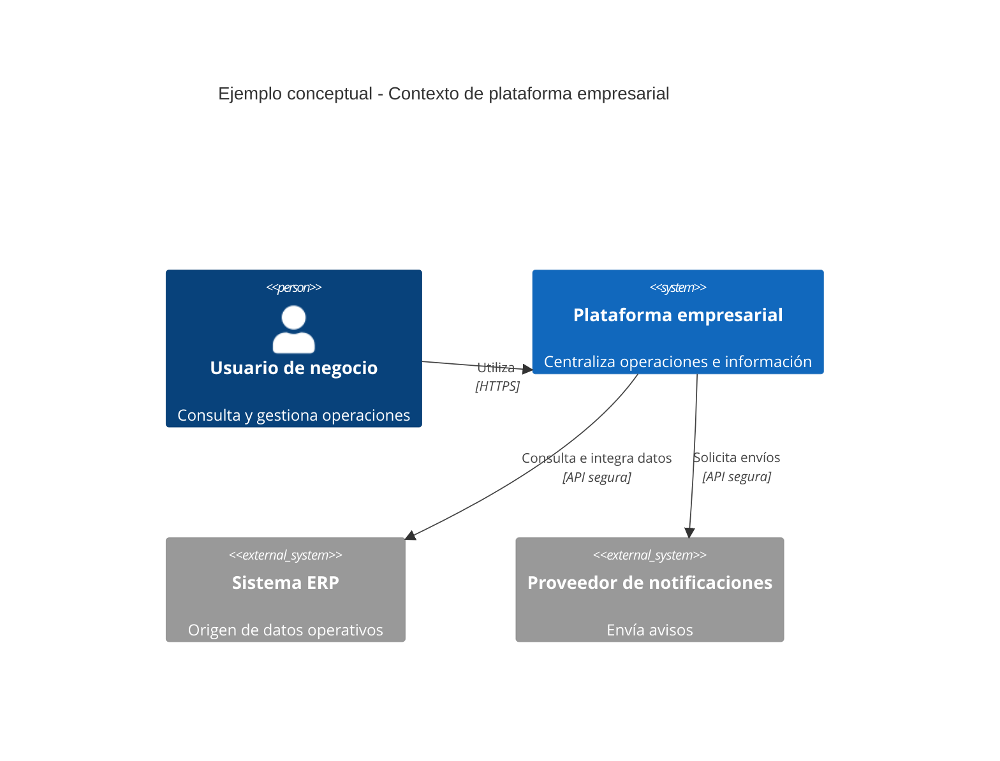
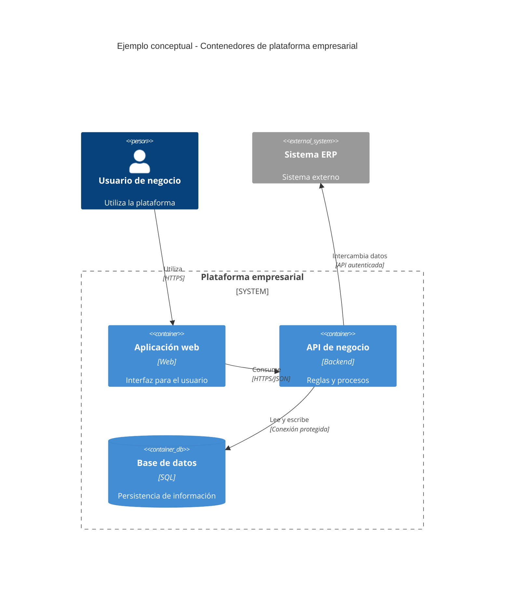
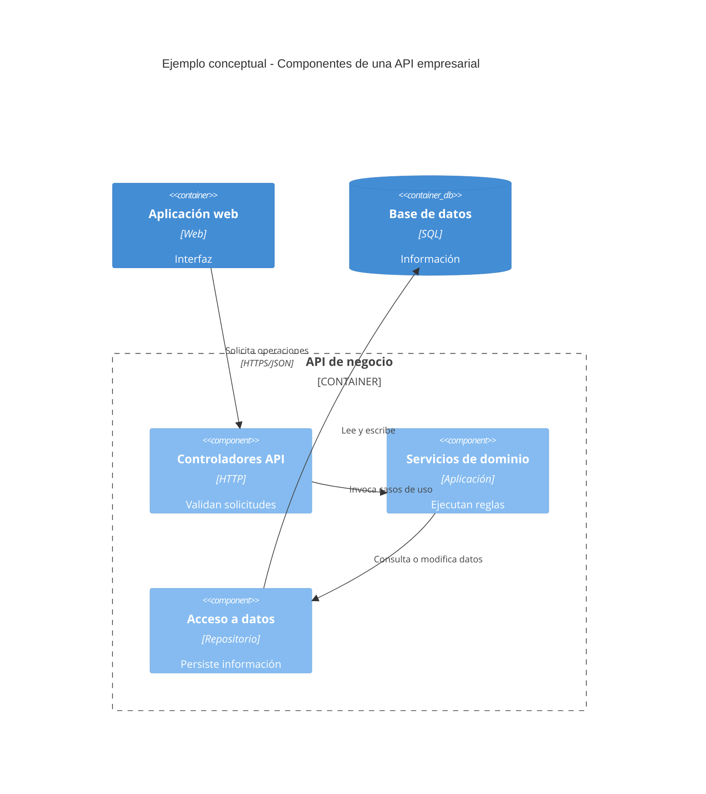
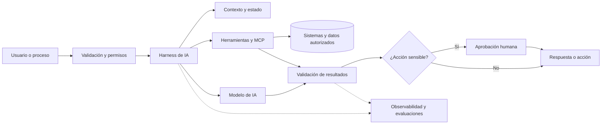

# FREDIIAN.DEV — Brief de contenido, diseño y desarrollo para Codex

> **Versión:** 1.0 · **Idioma principal:** español (Ecuador y Latinoamérica)  
> **Uso:** colocar este archivo en la raíz del proyecto y pedir a Codex que implemente o actualice `frediian.dev` conforme a estas especificaciones.  
> **Tipo de archivo:** Markdown UTF-8.  
> **Objetivo:** crear una web profesional, minimalista y convincente para una marca personal de desarrollo, arquitectura e ingeniería de soluciones tecnológicas.

---

## 0. Instrucción principal para Codex

**Implementa o actualiza el sitio `frediian.dev` utilizando este archivo como brief funcional, editorial y visual.**

1. **Inspecciona primero el repositorio existente**: framework, estructura de rutas, componentes, dependencias, contenido y archivos de identidad (`DESIGN.md`, logotipos, tipografías, iconos). **Conserva** lo ya aprobado y no sobrescribas cambios ajenos sin necesidad.
2. Si existe un `DESIGN.md` de Frediian, **tiene prioridad** para los colores, tipografía, logotipo y tokens visuales. La paleta aquí propuesta es únicamente un respaldo si no existe una guía vigente.
3. Crea un sitio **responsive, accesible, rápido, SEO-friendly y fácil de mantener**. Aprovecha el stack existente; no migres a otro framework sin una necesidad técnica clara.
4. Usa **exactamente el eslogan de marca**: **«Tecnología que resuelve. Tú avanzas.»**. No cambiarlo por otro.
5. Mantén una jerarquía clara: **beneficio para el cliente primero**, especialidades técnicas después. No conviertas la portada en un currículo ni en un catálogo de tecnologías.
6. Usa el texto de las secciones `Contenido público` como base editorial. Puedes ajustar puntuación y longitud para el diseño, pero **no inventes** títulos, certificaciones, años de experiencia, cifras, clientes, testimonios, proyectos, alianzas o resultados.
7. **No afirmes haber implementado una tecnología concreta en producción** si el material disponible solo indica interés, conocimiento o un servicio que se ofrece. La redacción debe ser veraz.
8. Construye CTA funcionales hacia `#contacto` o el mecanismo real que exista en el proyecto. No inventes teléfonos, correos electrónicos ni perfiles sociales. Si falta un dato, marca su configuración en un único lugar del código y utiliza un CTA interno mientras tanto.
9. No añadas dashboards privados, cuentas de usuario, pagos o integraciones de IA solo por estar mencionadas como **servicios de Frediian**. Este proyecto es una web pública de presentación, no la plataforma de IA que se oferta.
10. Al terminar, verifica compilación, contraste de color, navegación de teclado, estados de foco, imágenes, metaetiquetas, responsive y enlaces. Documenta los cambios realizados.

### Instrucción breve lista para pegar en Codex

> Lee `FREDIIAN_WEB_CODEX.md`, examina el proyecto y cualquier `DESIGN.md` existente y construye la web profesional de Frediian. Prioriza estética premium minimalista, contenido convincente en español, accesibilidad, responsive, rendimiento, SEO y fidelidad al contenido. Integra arquitectura C4, IA, MCP, harness de IA y desarrollo seguro como servicios. No inventes información ni enlaces. Ejecuta las verificaciones que permita el repositorio.

---

# 1. Estrategia de marca

- **Marca:** FREDIIAN
- **Dominio:** `https://frediian.dev`
- **Eslogan oficial:** Tecnología que resuelve. Tú avanzas.
- **Promesa de valor:** soluciones tecnológicas comprensibles para el negocio, bien diseñadas y preparadas para evolucionar.
- **Posicionamiento:** desarrollo de software, arquitectura de soluciones, inteligencia artificial aplicada e infraestructura con enfoque de seguridad.
- **Público:** empresas, emprendedores, instituciones y equipos que necesitan digitalizar, automatizar, integrar o modernizar procesos y sistemas; especial relevancia para Ecuador y Latinoamérica.
- **Personalidad:** profesional, humana, directa, confiable, actual, técnicamente sólida sin ser pretenciosa.
- **Diferenciación:** visión de extremo a extremo: entender el problema de negocio, diseñar su arquitectura, desarrollar y conectar sistemas, fortalecer su seguridad y acompañar su evolución.
- **Voz:** hablar de resultados y problemas reales antes que de tecnologías. Frases cortas. Evitar clichés, exageraciones, promesas absolutas y porcentajes.

### Principio editorial

**Titular = beneficio. Subtítulo = qué se hace. Detalle técnico = evidencia opcional. Acción = conversación.**

No llamar al propietario “empresa líder”, “experto certificado” ni atribuir certificaciones que no estén confirmadas. No presentar cargos pasados como avales contractuales ni usar marcas de empleadores sin permiso.

---

# 2. Arquitectura de información (sitio)

## Navegación recomendada

1. Inicio (`#inicio`)
2. Soluciones (`#soluciones`)
3. Arquitectura e IA (`#arquitectura-ia`)
4. Sobre mí (`#sobre-mi`)
5. Contacto (`#contacto`)

Sitio preferentemente **one-page** bien estructurado; habilitar páginas independientes únicamente si el repositorio ya cuenta con ellas o el contenido crece de forma justificada. Encabezado sticky discreto, navegación móvil accesible y CTA visible.

## Orden de conversión

1. Hero: identificación + promesa clara + llamada a la acción.
2. Problemas que resolvemos: conectar con necesidades cotidianas del cliente.
3. Soluciones: servicios en lenguaje simple.
4. Arquitectura e IA: capacidad técnica diferencial, presentada visualmente.
5. Forma de trabajo: demostrar orden y confianza.
6. Sobre mí: credibilidad y experiencia, sin currículo extenso.
7. CTA final / contacto: mínimo esfuerzo para contactar.
8. Pie: marca, lema, navegación y enlaces verificados.

---

# 3. Contenido público final — usar en la web

## 3.1. Hero `#inicio`

**Eyebrow:** DESARROLLO · ARQUITECTURA · INTELIGENCIA ARTIFICIAL

**H1:** Tecnología que resuelve. Tú avanzas.

**Subtítulo:** Diseño y desarrollo soluciones de software, arquitectura e inteligencia artificial para que tu negocio trabaje mejor, se conecte y evolucione con confianza.

**CTA principal:** Hablemos de tu proyecto

**CTA secundario:** Explorar soluciones

**Microcopy:** De la idea a una solución bien diseñada.

> Sugerencia UX: H1 breve, máximo dos líneas prominentes cuando sea posible. Mantener fotografía o ilustración abstracta relacionada con sistemas conectados y arquitectura, **sin** recurrir a fotografías de personas de stock que aparenten ser el autor.

## 3.2. Bloque de empatía con el problema

**Título:** Cuando la tecnología complica, el negocio se detiene.

**Texto:** Procesos manuales, sistemas que no se comunican y herramientas difíciles de mantener consumen tiempo y frenan nuevas oportunidades. El primer paso no es programar más: es entender qué necesitas resolver.

**Remate:** Menos complejidad. Más claridad. Soluciones que funcionan.

## 3.3. Servicios `#soluciones`

**Título:** Soluciones pensadas para desafíos reales.

**Introducción:** Cada proyecto comienza por un objetivo de negocio. La tecnología es el medio para alcanzarlo.

### Tarjeta 1 — Desarrollo de software y APIs

- **Título corto:** Software a medida
- **Texto visible:** Aplicaciones, servicios e integraciones diseñados alrededor de tus procesos, no al revés.
- **Detalle ampliable:** Aplicaciones web y de escritorio, APIs, mantenimiento y modernización de sistemas, integración de datos, control de versiones y flujos de entrega.
- **Ícono sugerido:** `code-2`

### Tarjeta 2 — Arquitectura de soluciones y C4

- **Título corto:** Arquitectura que da claridad
- **Texto visible:** Diseño sistemas comprensibles, conectados y preparados para crecer sin complejidad innecesaria.
- **Detalle ampliable:** Diagramas C4 de contexto, contenedores y componentes; nivel de código cuando agrega valor; decisiones arquitectónicas (ADR), integraciones, resiliencia, disponibilidad, recuperación y atributos de calidad.
- **Ícono sugerido:** `blocks`

### Tarjeta 3 — IA aplicada, agentes y MCP

- **Título corto:** IA conectada a tu negocio
- **Texto visible:** Integro inteligencia artificial con procesos, herramientas y datos para crear experiencias útiles y automatizaciones con propósito.
- **Detalle ampliable:** Asistentes y agentes de IA, conexión a sistemas mediante APIs y Model Context Protocol (MCP), acceso controlado a herramientas, flujos con supervisión humana y validación de resultados.
- **Ícono sugerido:** `brain-circuit`

### Tarjeta 4 — Harness de IA y automatización confiable

- **Título corto:** Agentes con control
- **Texto visible:** Más que una respuesta inteligente: procesos de IA con herramientas, límites claros, validación y trazabilidad.
- **Detalle ampliable:** Diseño de *harness* para agentes: gestión de contexto y estado, coordinación de herramientas y tareas, políticas de permisos, aprobaciones, pruebas, evaluaciones, registros y recuperación ante fallos.
- **Ícono sugerido:** `workflow`

### Tarjeta 5 — Desarrollo seguro de software

- **Título corto:** Seguridad desde el diseño
- **Texto visible:** La seguridad forma parte de las decisiones de arquitectura, desarrollo y operación desde el inicio.
- **Detalle ampliable:** Prácticas de ciclo de vida de desarrollo seguro (SSDLC), revisión de código, gestión de dependencias, control de secretos, autenticación, autorización, pruebas, CI/CD y enfoques basados en OWASP y NIST SSDF según el contexto del proyecto.
- **Ícono sugerido:** `shield-check`

### Tarjeta 6 — Datos e infraestructura

- **Título corto:** Sistemas, datos e infraestructura
- **Texto visible:** Infraestructura sólida y datos bien organizados para mantener tus servicios disponibles y tomar mejores decisiones.
- **Detalle ampliable:** SQL Server, reportes SSRS, automatización de reportes, administración de servidores Windows, entornos virtuales, servicios web, redes, respaldos, monitoreo y continuidad operativa.
- **Ícono sugerido:** `database`

**CTA de sección:** Cuéntame qué necesitas resolver

## 3.4. Sección diferencial `#arquitectura-ia`

**Título:** Ingeniería con visión. Innovación con control.

**Introducción:** Una buena solución no depende de sumar herramientas, sino de tomar las decisiones correctas desde el diseño. Combino arquitectura, desarrollo seguro e inteligencia artificial para crear tecnología útil, explicable y mantenible.

**Tres pilares visibles:**

#### Arquitectura que puedes entender

De la visión general al detalle técnico, los diagramas C4 permiten comunicar cómo se relacionan personas, sistemas, aplicaciones y componentes. Las decisiones importantes quedan documentadas para facilitar evolución y mantenimiento.

**Etiqueta técnica secundaria:** C4 · ADR · Integraciones · Resiliencia

#### Inteligencia artificial con propósito

Uso IA y protocolos como MCP para conectar asistentes y agentes con herramientas y fuentes de información. Cada integración debe aportar una función real y respetar los permisos y límites del sistema.

**Etiqueta técnica secundaria:** IA aplicada · Agentes · MCP · Automatización

#### Desarrollo seguro y verificable

Diseño con seguridad desde el inicio: controles de acceso, validaciones, pruebas y entregas trazables. En soluciones con agentes, un *harness* organiza la ejecución y la supervisión para disminuir comportamientos inesperados.

**Etiqueta técnica secundaria:** SSDLC · DevSecOps · Guardrails · Evals

**Cierre de sección:** Tecnología avanzada. Decisiones claras. Soluciones responsables.

### Definiciones para un pequeño glosario desplegable

- **Diagramas C4:** mapas de una arquitectura de software en distintos niveles, desde el contexto del negocio hasta sus componentes.
- **MCP (Model Context Protocol):** estándar abierto que permite conectar aplicaciones de IA con herramientas, fuentes de datos y flujos externos.
- **Harness de IA:** capa que organiza el trabajo de un agente: contexto, ejecución, herramientas, permisos, aprobación humana, seguimiento, pruebas y recuperación.
- **Desarrollo seguro:** prácticas que incorporan seguridad en análisis, diseño, programación, pruebas, despliegue y mantenimiento.

> **Diseño:** mostrar primero beneficios. Glosario técnico en acordeones discretos o paneles accesibles, no en grandes bloques de texto.

## 3.5. Método de trabajo

**Título:** Entender. Diseñar. Construir. Mejorar.

1. **Escuchar el reto.** Comprendo el negocio, los usuarios y las restricciones antes de proponer tecnología.
2. **Diseñar con criterio.** Defino arquitectura, integraciones, riesgos y una ruta de implementación realista.
3. **Construir y validar.** Desarrollo con control de cambios, pruebas, criterios de calidad y prácticas de seguridad.
4. **Evolucionar con confianza.** Documento, optimizo y preparo la solución para nuevas necesidades.

**Cierre:** Soluciones bien pensadas, sin complejidad innecesaria.

## 3.6. Sobre mí `#sobre-mi`

**Título:** Detrás del código, una visión de negocio.

**Biografía para la web:**

Soy el profesional detrás de **Frediian**. Mi trayectoria reúne desarrollo de software, administración de sistemas e infraestructura tecnológica, con experiencia en los sectores financiero y público.

He trabajado con aplicaciones empresariales, bases de datos, reportes, redes y servicios críticos. Esa experiencia me permite conectar el desarrollo con la operación real de una organización: entender cómo funciona, identificar riesgos y diseñar soluciones sostenibles.

Hoy enfoco mi trabajo en arquitectura de soluciones, software seguro, automatización e inteligencia artificial aplicada, manteniendo una idea central: **la tecnología debe resolver problemas y facilitar el avance de las personas y sus negocios.**

**Frase destacada:** No se trata solo de escribir código. Se trata de resolver el problema correcto.

### Experiencia resumida (opcional como línea temporal, SIN detalles innecesarios)

- **2025–actualidad:** Analista de Desarrollo y Programación — cooperativa de ahorro y crédito.
- **2024–2025:** Responsable de Tecnologías de la Información — cooperativa de ahorro y crédito.
- **2022–2024:** Analista de Tecnologías de la Información — sector público educativo.
- **2020–2021:** Soporte e infraestructura tecnológica — sector público electoral.

**Regla:** mostrar línea temporal solo si beneficia la credibilidad de la página. No convertir la página de inicio en una hoja de vida. Evitar revelar información interna, activos o sistemas sensibles de los empleadores.

## 3.7. CTA final `#contacto`

**Título:** Tu próxima solución comienza con una conversación.

**Texto:** ¿Necesitas desarrollar una aplicación, integrar sistemas, automatizar procesos o explorar cómo aplicar IA a tu negocio? Cuéntame el desafío y encontremos una solución que tenga sentido.

**CTA:** Hablemos de tu proyecto

**Texto de apoyo:** Una buena solución empieza por entender lo que realmente necesitas.

### Formulario de contacto sugerido

- Nombre
- Correo electrónico
- ¿En qué puedo ayudarte? (opciones: Software; Arquitectura C4; IA y automatización; Desarrollo seguro; Datos e infraestructura; Otro)
- Cuéntame brevemente tu idea (campo texto)
- Consentimiento para uso de datos de contacto, con acceso a política de privacidad cuando esté publicada
- Botón: **Enviar consulta**

Si **no existe backend** para recibir mensajes, no simular envío exitoso. Usar un canal de contacto real **configurado por el propietario** o mostrar un formulario inactivo con mensaje claro durante desarrollo, nunca en la publicación final. Incorporar validación, protección anti-spam y no registrar información sensible.

## 3.8. Pie de página

**FREDIIAN**  
Tecnología que resuelve. Tú avanzas.  
Desarrollo · Arquitectura · IA · Seguridad  
`frediian.dev`

Links: Inicio | Soluciones | Sobre mí | Contacto | Política de privacidad (solo si existe).  
Año dinámico del sistema. No inventar dirección, email, WhatsApp ni redes sociales.

---

# 4. Copys cortos para publicidad y redes

## Anuncio principal

**¿Tu negocio necesita tecnología que realmente funcione?**

Software a medida, arquitectura de sistemas e inteligencia artificial aplicada para resolver retos reales.

**Menos complicaciones. Más soluciones.**  
**FREDIIAN** — Tecnología que resuelve. Tú avanzas.  
`frediian.dev`

## Anuncio arquitectura

**Antes de construir, hay que diseñar bien.**

Arquitectura de software con diagramas C4, integraciones claras y decisiones técnicas que ayudan a evolucionar tus sistemas.

**FREDIIAN** — De la idea a una solución bien pensada.

## Anuncio IA

**La IA aporta valor cuando se conecta con tu negocio.**

Agentes, automatizaciones e integraciones MCP con controles, validación y supervisión.

**FREDIIAN** — Tecnología que resuelve. Tú avanzas.

## Anuncio seguridad

**La seguridad no debe esperar al final.**

Desarrollo de software con criterios de seguridad desde el diseño hasta la entrega.

**FREDIIAN** — Construir bien también es proteger.

## Biografía ultracorta para perfiles

**Software · Arquitectura C4 · IA y MCP · Desarrollo seguro**  
Soluciones tecnológicas para negocios que quieren avanzar.  
**FREDIIAN — Tecnología que resuelve. Tú avanzas.**

---

# 5. Dirección visual y experiencia UX/UI

## Concepto

**Tecnología cercana, precisa y confiable.** Estética editorial minimalista, sofisticada pero no fría. Mucho espacio en blanco, tipografía legible, tarjetas discretas, visuales claros y microinteracciones sobrias.

### Identidad

1. Si existe `DESIGN.md`, seguirlo. El logotipo existente aprobado tiene prioridad.
2. Evitar una «f» que recuerde al logotipo de Facebook o a otras redes. No usar su silueta, caja, proporciones ni tratamiento como referente.
3. Si faltan tokens de diseño, usar **temporalmente**:
   - Fondo profundo: `#101B30`
   - Superficie clara: `#F7F9FC`
   - Acento turquesa: `#19B7B0`
   - Acento claro: `#55D8D0`
   - Texto principal oscuro: `#162338`
   - Texto secundario: `#526378`
   - Blanco: `#FFFFFF`
4. Elegir una familia tipográfica moderna y legible; utilizar las fuentes ya configuradas en el proyecto. Priorizar velocidad de carga y licencias apropiadas.
5. Fondo principal limpio, gradientes muy suaves y un motivo abstracto de conexiones o nodos si no distrae de los textos.
6. Íconos con una librería consistente, sin mezclarlos con emojis en los componentes visuales del sitio.

### Composición

- Hero en dos columnas en escritorio; texto dominante a la izquierda, visual técnico abstracto a la derecha. En móvil, primero título/CTA.
- Títulos con contraste tipográfico, texto corto, anchura legible.
- Rejilla de seis servicios: tres columnas en pantallas amplias, dos en tablet y una en móvil.
- Sección `Arquitectura e IA`: tres pilares con una visualización pequeña y clara, o pestañas accesibles para Arquitectura / IA / Seguridad.
- CTA principal visualmente consistente en todas las secciones.
- No saturar con códigos, matrices, diagramas gigantes ni múltiples carruseles.
- No recurrir a cifras, porcentajes ni métricas inventadas para generar credibilidad.

### Interacciones

- Animaciones breves y discretas al aparecer en pantalla; respetar `prefers-reduced-motion`.
- Efectos hover/focus sutiles que no escondan información importante.
- Menú móvil operable con teclado y lector de pantalla.
- Acordeón accesible para términos técnicos; cerrado por defecto.
- Enlaces y botones claramente distinguibles.

---

# 6. Demostración opcional de arquitectura C4 en la web

**Objetivo:** enseñar visualmente el tipo de documentación arquitectónica que ofrece Frediian, **sin atribuir el sistema ficticio a un cliente real**.

Usar un módulo compacto: **«Así hacemos visible una arquitectura»**, con selector `Contexto / Contenedores / Componentes`. El ejemplo será un **sistema empresarial ilustrativo**, no un caso real. No es obligatorio usar una librería de diagramación pesada: SVG responsive o componentes existentes sirven, siempre que representen correctamente actores, límites, sistemas y relaciones.

**C4 — Niveles:**

- **Contexto:** personas, sistema central y dependencias externas.
- **Contenedores:** aplicaciones, servicios y almacenes de datos dentro del sistema.
- **Componentes:** responsabilidades e interacciones dentro de un contenedor específico.
- **Código:** detalle de implementación, opcional cuando aporta valor.

## Ejemplo ilustrativo — Contexto (Mermaid C4)

## Ejemplo ilustrativo — Contenedores (Mermaid C4)

## Ejemplo ilustrativo — Componentes (Mermaid C4)

**Nota para Codex:** no renderizar el Markdown fuente como texto en la interfaz pública. Si el motor Mermaid C4 no está disponible o falla en el proyecto, implementar una visualización equivalente con SVG o HTML accesible. Evitar líneas que crucen cajas y textos superpuestos. En móvil, preferir pila vertical o desplazamiento horizontal accesible con etiqueta.

---

# 7. Diagrama conceptual de IA y harness (uso editorial, NO servicio operativo del sitio)

Bloque técnico ilustrativo para la sección Arquitectura e IA. No implica que el sitio web ejecute agentes.

**Texto visible junto a la ilustración:** «La IA es más útil cuando trabaja con contexto, herramientas adecuadas y controles claros.»

**Buenas prácticas que deben comunicarse sin prometer seguridad absoluta:** permisos mínimos, trazabilidad, evaluación, límites operativos, resguardo de datos y revisión humana para acciones sensibles.

---

# 8. SEO y contenidos técnicos

## Metadatos

- **Title:** `Frediian | Desarrollo de Software, Arquitectura e IA`
- **Meta description:** `Desarrollo de software, arquitectura C4, inteligencia artificial, MCP y soluciones seguras para empresas. Frediian: Tecnología que resuelve. Tú avanzas.`
- **Idioma:** `es-EC` o `es` según configuración existente.
- **Canonical:** `https://frediian.dev/`
- **Open Graph:** título, descripción, URL y **una imagen OG original** si el proyecto ya tiene material visual autorizado. No inventar fotos ni logotipos.
- **H1:** solo uno, el del hero.
- **Encabezados:** H2 por sección, H3 por servicio/pilar.
- **Schema.org:** `WebSite` y, si hay datos suficientes, `Person` u `Organization` según sea correcto. No rellenar datos faltantes ni perfiles ficticios.
- **Rendimiento:** imágenes optimizadas, carga diferida donde corresponda, fuentes eficientes, evitar JavaScript pesado por motivos decorativos.
- **SEO local:** lenguaje natural adecuado a Ecuador y Latinoamérica, sin inventar direcciones comerciales.

## Accesibilidad y calidad

- Controles con semántica HTML correcta; foco visible; formularios con etiquetas y errores claros.
- Contraste alineado a WCAG AA cuando corresponda.
- Diseño mobile-first con espacios suficientes y sin cortes horizontales.
- Imágenes con `alt` adecuado; decorativas con `alt=""`.
- Política de privacidad coherente con los datos de contacto que realmente se recopilen.
- No recopilar secretos ni datos sensibles en el formulario.
- Evitar enlaces que lleven a `#` sin acción real.

## Tecnologías en una sección secundaria (no en el hero)

Si se muestra una nube de competencias o un apartado de herramientas:

**Desarrollo:** C#, JavaScript, SQL, PHP, Python, APIs, Git, CI/CD.  
**Datos:** SQL Server, SSRS, MySQL, reportes y automatización.  
**Infraestructura:** Windows Server, redes LAN/WAN, servicios web, virtualización, Fortinet, monitoreo y respaldos.  
**Arquitectura y procesos:** C4, UML, BPMN, ADR, Kanban, gestión de proyectos.  
**Ingeniería responsable:** seguridad desde el diseño, buenas prácticas OWASP/NIST, evaluación de integraciones y cambios.  
**IA aplicada:** automatización, agentes, conectividad MCP y diseño de harness.

**No etiquetar seniority o certificación** sin datos verificables específicos.

---

# 9. Entregables esperados de Codex

- Sitio completo o actualización del proyecto actual respetando su stack.
- Componentes reutilizables y datos de servicios editables.
- Contenido final en español, fiel a este brief.
- Diseño responsive con comportamiento móvil cuidado.
- Sección C4 / IA ilustrativa sin afirmar que es un caso de cliente.
- CTA funcionales y contacto sin datos inventados.
- SEO básico, accesibilidad y optimización de carga.
- Sin dependencias innecesarias ni integraciones de IA ejecutándose en la web pública.
- Verificación de build/lint/tests disponibles, con resumen de resultados.

## Criterios de aceptación

- [ ] Eslogan exacto en hero y footer.
- [ ] El visitante entiende qué hace Frediian antes de llegar a contenidos técnicos.
- [ ] Existen servicios de arquitectura C4, IA/MCP, harness de IA y desarrollo seguro.
- [ ] Las tarjetas son breves, legibles y sin saturación.
- [ ] No hay estadísticas, porcentajes, clientes o testimonios inventados.
- [ ] La identidad visual existente se ha preservado.
- [ ] La navegación, botones y contacto funcionan o notifican claramente una configuración pendiente antes de publicar.
- [ ] El sitio se ve bien en móvil, tablet y escritorio.
- [ ] Se evitan dependencias innecesarias y fallos en consola.
- [ ] La accesibilidad básica, metadatos y rendimiento se han revisado.

---

# 10. Referencias técnicas para orientar la implementación (no publicar como bibliografía en la portada)

- Modelo C4: https://c4model.com/diagrams
- Especificación y conceptos MCP: https://modelcontextprotocol.io/introduction
- Arquitectura de MCP: https://modelcontextprotocol.io/docs/learn/architecture
- Desarrollo seguro NIST SSDF: https://csrc.nist.gov/pubs/sp/800/218/final
- OWASP SAMM: https://owasp.org/www-project-samm/
- Arquitectura de agentes, controles y revisión humana: https://developers.openai.com/api/docs/guides/agents/sdk
- Concepto de harness de agentes: https://developers.openai.com/blog/codex-as-a-platform

**Importante:** estas referencias permiten mantener un significado correcto de los términos, pero **no** justifican afirmar una certificación o cumplimiento formal de sus estándares. La aplicación de cada práctica depende del alcance real del proyecto.

---

## Mensaje central para no perder el enfoque

> **FREDIIAN**  
> **Tecnología que resuelve. Tú avanzas.**  
> Software, arquitectura e inteligencia artificial para convertir desafíos tecnológicos en soluciones que impulsan tu negocio.
